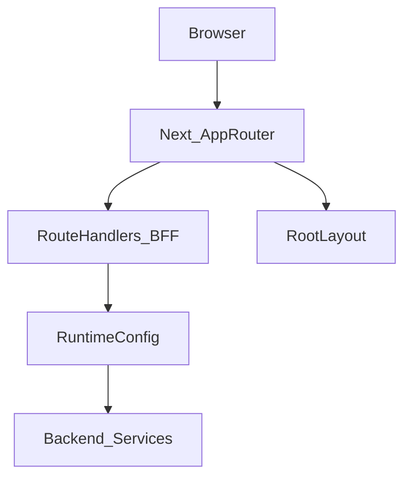

# 官网工程规范

> 面向要**借鉴本项目（cvte-campus-portal）搭建另一套官网**的同事。  
> 借鉴的是**分层、BFF、样式分工、协作文档**；**不要**为了「和本仓一模一样」锁定 Next.js 13。

## 1. 文档说明

| 项 | 说明 |
|----|------|
| 适用场景 | 营销 / 招聘类官网（展示为主、少量表单交互） |
| 阅读路径 | 先读本文 → 需要本仓细节再看下方附录四件套 |
| 本仓角色 | **模式参考**（Next 13 + Pages Router 为历史选型） |
| 新官网角色 | **较新 Next + App Router**（落地时查官方最新 stable） |

约定标记：

- **[通用]**：建议新官网直接沿用
- **[本项目特有]**：Apollo / CIAC / `@cvte/*` 等，可换成等价方案

---

## 2. 技术栈基线 [通用]

### 2.1 双轨对照

| 维度 | 本仓现状（参考，勿照搬版本） | 新官网推荐 |
|------|------------------------------|------------|
| 框架 | Next.js 13.1 + Pages Router（见 [DECISIONS.md](./DECISIONS.md) ADR-001） | **最新稳定版 Next.js**（撰写时以 **15.x** 为准，落地时查官方 stable）+ TypeScript |
| 路由 | `src/pages/` | **默认 App Router（`src/app/`）**；仅当团队明确要兼容旧页模式时才用 Pages |
| UI | Ant Design 5 + Tailwind 3 + SCSS Module | 同分工；Tailwind 可跟脚手架升到 v4（可选） |
| 请求 | axios（BFF）+ ahooks `useRequest` / react-query 3 | 同思路；新项目用 **TanStack Query v5** 替代 react-query 3 |
| 包管理 | yarn | yarn 或 pnpm，团队二选一写死 |

### 2.2 选型原则

- **Do**：新官网用较新 Next + App Router；能 Server Component 拿的数据优先服务端取。
- **Don't**：故意选 Next 13「对齐本仓」；不要默认上 Redux / Zustand（服务端状态远多于客户端状态时）。
- 若需**启动时**拉配置中心：可用自定义 server / 容器启动钩子；「不要默认假设 Vercel 零配置」≠ 否定新版 Next。

---

## 3. 目录与模块边界 [通用]

### 3.1 新官网推荐目录

```
src/app/                      # App Router：layout / page / loading / error
src/app/api/                  # Route Handlers 作为 BFF（对应本仓 pages/api）
src/components/layouts/       # 全局壳（Header / Footer / Meta；也可部分下沉到 app/layout）
src/components/in-page/       # 单页业务组件（目录名与路由段对应）
src/components/universal/     # 跨页复用（确认 ≥2 页再用）
src/hooks/                    # 客户端边界、视口动画等轻量 hooks
src/utils/                    # 工具与请求封装
src/types/                    # 业务类型
src/constants/                # 静态配置
src/styles/                   # 全局样式 / CSS 变量
config/                       # 环境与运行时合并配置
public/                       # 静态资源
docs/                         # ARCHITECTURE / STANDARDS / ROUTES / DECISIONS
```

路径别名：`@/*` → `src/*`。

### 3.2 组件放置原则

| 目录 | 条件 | 示例 |
|------|------|------|
| `layouts/` | 影响全局布局 | Header、Footer、Meta |
| `in-page/` | 只在一个页面使用 | Home/Banner、Position/List |
| `universal/` | 至少在 2 个以上页面复用 | Animate、Button、Title |

**原则**：新组件默认放 `in-page/`，确认跨页面复用时才提升到 `universal/`。  
**原则**：`page.tsx`（或本仓页面文件）保持薄，业务下沉到 `in-page/`。

### 3.2.1 多页面合并的共享壳门禁

- 合并两个及以上页面为 React 项目时，必须逐路由审计 Header、Nav、Footer，不能默认保留逐页复制实现。
- 两个及以上页面的共享壳相同，或差异仅为激活项、主题、资源、文案、可选操作等可参数化变体时，必须抽取到 `components/layouts/` 并由所有消费路由实际引用。
- 只有结构、交互或响应式行为存在不可安全参数化的实质差异时才允许保留页面私有实现，并在审计中记录证据；缺少某区域也必须明确记录。
- 抽取前后必须在同一路由、同一视口对 Header/Nav/Footer 区域做视觉回归。尺寸必须一致，默认 changed-pixel ratio 不得超过 `0.005`；失败时修复共享组件或撤销该族抽取，不能将样式漂移作为已知偏差交付。
- 继承 `mastergo2html.responsive-contract.v1` 的项目必须覆盖 `390 / 768 / 1280 / 1920 / 2560` 五档。

本仓细则见 [STANDARDS.md](./STANDARDS.md)。

### 3.3 本仓 → 新项目映射

| 本仓（Pages Router） | 新官网（App Router） |
|----------------------|----------------------|
| `src/pages/_app.tsx` | `src/app/layout.tsx` + 必要的 Client Provider |
| `src/pages/_document.tsx`（若有） | `layout.tsx` 的 `<html>` / `<body>` |
| `src/pages/foo/index.tsx` | `src/app/foo/page.tsx` |
| `src/pages/api/**` | `src/app/api/**/route.ts` |
| `getServerSideProps` / `getStaticProps` | Server Components / `fetch` / `generateStaticParams` |
| `next/config` 的 `serverRuntimeConfig` | 环境变量、`server-only` 模块、或启动时注入的配置模块 |
| `middleware.ts` matcher | 同名，按 App Router 约定配置 matcher |

---

## 4. 架构与数据流 [通用]



### 4.1 必须遵守的边界

1. **浏览器 / 页面不直连后端微服务**；统一走同域 `/api/*`（或团队选定的同域 Server Action，仍须集中鉴权与配置）。
2. **BFF** 负责：解析配置、服务鉴权、调用后端、错误包装；**客户端**只处理成功态 + loading。
3. 统一响应形态建议：`{ status, data?, msg? }`（与本仓 `messageHelper` 思路一致）。
4. 按钮 / 用户触发的请求**必须有 loading**。

### 4.2 配置与鉴权 [本项目特有 → 可替换]

本仓做法：

- 自定义 `server.js` 启动时再执行 `next.config.js`，从 **Apollo** 拉配置写入 `serverRuntimeConfig` / `publicRuntimeConfig`。
- BFF 使用 `src/utils/request.ts`（axios），经 **CIAC** 注入 `access-token`。
- 详情见 [ARCHITECTURE.md](./ARCHITECTURE.md)。

新项目等价替换（保留 BFF 边界即可）：

| 本仓 | 可替换为 |
|------|----------|
| `@cvte/apollo-node-client` | 环境变量、自有配置中心、密钥管理服务 |
| `@cvte/ciac` token | 自有服务鉴权 / mTLS / 网关签发的服务凭证 |
| `getConfig().serverRuntimeConfig` | `process.env` + `server-only` 配置模块 |
| 自定义 `server.js` | 容器 entrypoint、K8s init、或平台支持的启动钩子 |

---

## 5. 编码与命名约定 [通用]

| 类型 | 规则 | 示例 |
|------|------|------|
| 组件 | PascalCase 目录 + `index.tsx` | `Banner/index.tsx` |
| 样式 | 与组件同名 `.module.scss` | `Banner.module.scss` |
| 工具 / 类型 / 常量 | camelCase.ts | `request.ts`、`position.ts` |
| API Route 文件 | kebab-case 路径段 | `app/api/campus-news/route.ts` |
| 有 TS 只改 TS | 不改编译产物 JS | — |

### 5.1 格式化与 Lint 基线（可直接抄）

Prettier 参考本仓：

- `singleQuote: true`
- `semi: true`
- `printWidth: 120`
- `arrowParens: "avoid"`

ESLint：`extends: next/core-web-vitals`（新项目用脚手架默认即可，再按需微调）。

### 5.2 Do / Don't

| Do | Don't |
|----|-------|
| 后端 URL 走配置，禁止硬编码 host | 在组件里写死后端域名 |
| 接口变更时前端与 Node/配置同步改 | 只改一端导致联调漂移 |
| CDN 图片超过 1MB **必须压缩后上传** | 直接上传超大原图 |
| 改 `next.config` 时核对自定义 server / 部署入口 | 只改配置忘了启动脚本 |

---

## 6. 样式与主题 [通用]

| 场景 | 方案 |
|------|------|
| 布局、间距、颜色、字体、响应式断点 | Tailwind |
| 复杂动画、keyframes、伪类、嵌套选择器 | SCSS Module |
| Modal、Drawer、Form 等交互组件 | Ant Design |

**原则**：Tailwind 能解决的场景不要用 SCSS。

主题建议：

- 全局 CSS 变量（背景、Header 主题色等）放在 `styles/globals.css`
- 按路由切换主题时在 Layout 层统一处理（本仓参考 `pageTheme` / `BasicLayout`）
- Ant Design 全局覆盖可集中在一份 `custom.scss`，避免散落改 antd 类名

本仓品牌色示例：`primary: #de201b`（新官网换成自己的品牌色即可）。

---

## 7. 页面与数据约定 [通用]

### 7.1 布局注入

- 根 `layout.tsx` 统一注入：全局壳、主题、Ant Design（注意 App Router 下的 Style Registry）、TanStack Query Provider。
- 需要浏览器 API 的 Provider 放在 `'use client'` 边界组件内，避免污染整树为客户端组件。

### 7.2 数据获取

- **优先**：Server Component / Route Handler 服务端取数。
- **需要客户端缓存、轮询、依赖用户操作**：TanStack Query v5 或 ahooks `useRequest`，且带 loading。
- 本仓「多数页面客户端打 BFF」可作为**简单起步**，但新项目**鼓励**合理使用 RSC，不必复刻「几乎不用 SSR」的历史状态。

### 7.3 Hooks 职责

自定义 hooks 偏 UI / SSR 安全（如首次入视动画、客户端标记）；**不要**把所有数据请求塞进杂乱 hooks 而绕过 BFF。

---

## 8. 资源与配置变更 [通用] + [本项目特有]

### 8.1 通用

- 静态图片放 `public/`；设计转代码资产可单独目录管理（本仓为 `.codify/design/`）。
- 修改 Tailwind `content` / 扫描路径时，确保覆盖 `app/`、`components/` 等全部组件目录。
- 文档与代码同步：新增页面或 API 时更新 `docs/ROUTES.md`（或新项目等价路由表）。

### 8.2 本项目特有（了解即可）

| 项 | 说明 |
|----|------|
| `CONFIG_ENV` | `dev` / `pro`，控制 Apollo 与本地 `config/projects` 合并 |
| 开发端口 | `7777`（`yarn dev`） |
| Apollo | namespace `campus-portal` 等，见启动与 `apollo` 相关文件 |
| 包管理 | 本仓使用 **yarn**（有 `yarn.lock`） |

脚本参考：

- 开发：`CONFIG_ENV=dev next dev -p 7777`
- 构建：`CONFIG_ENV=pro next build`
- 生产：`NODE_ENV=production node server.js`（自定义 server）

---

## 9. 新官网落地检查清单

按顺序打勾：

1. [ ] 用官方脚手架初始化**最新稳定版** Next（App Router）+ TypeScript；包管理锁定 yarn 或 pnpm  
2. [ ] 建立三层组件目录：`layouts` / `in-page` / `universal`  
3. [ ] 建立 `docs/` 四件套空模板：`ARCHITECTURE` / `STANDARDS` / `ROUTES` / `DECISIONS`  
4. [ ] 实现 `app/api` BFF 骨架 + 统一 request 封装 + `{ status, data, msg }`  
5. [ ] 配置与鉴权选型落地（环境变量或配置中心；**禁止**前端硬编码后端 host）  
6. [ ] 接入 Tailwind + SCSS Module + Ant Design，并定品牌色 / CSS 变量  
7. [ ] 完成 root `layout.tsx` + 首页薄 `page.tsx` + 至少一个 `in-page` 业务块  
8. [ ] 确认部署方式（容器自定义入口 / 托管平台）；启动时拉配置则写清 entrypoint  
9. [ ] 补全 ROUTES 表与至少一条 ADR；注明「模式借鉴 cvte-campus-portal，框架版本不锁定 13」  
10. [ ] ESLint / Prettier / CI lint 跑通；约定「按钮请求必有 loading」「CDN 图 >1MB 先压缩」

---

## 10. 附录

### 10.1 本仓文档索引

| 文档 | 用途 |
|------|------|
| [ARCHITECTURE.md](./ARCHITECTURE.md) | 整体架构、自定义 Server、组件三层、样式与状态 |
| [STANDARDS.md](./STANDARDS.md) | 组件分类、API、命名、图片与配置变更 |
| [ROUTES.md](./ROUTES.md) | 本仓页面 / API 映射（业务细节，勿整表抄进新项目） |
| [DECISIONS.md](./DECISIONS.md) | ADR（含 Pages Router、自定义 Server、BFF、样式混用等） |

### 10.2 本项目特有依赖对照

| 包 / 能力 | 用途 | 新项目建议 |
|-----------|------|------------|
| `@cvte/apollo-node-client` | 配置中心 | 自有配置或环境变量 |
| `@cvte/ciac` | BFF→后端鉴权 | 自有服务凭证方案 |
| `@cvte/koa-messages` / `@cvte/koa-redis` | 消息 / 缓存（按需） | 按实际依赖引入，非官网必备 |
| `react-query@3` | 服务端状态 | TanStack Query v5 |
| 自定义 `server.js` | 启动时刷新 Apollo | 等价启动钩子或纯 `next start`（无动态配置时） |

### 10.3 一句话总结

> **抄模式，不抄版本号。**  
> 三层组件 + BFF + Tailwind/SCSS/Antd 分工 + docs 四件套 = 可迁移核心；Next 用当前稳定版 + App Router。
